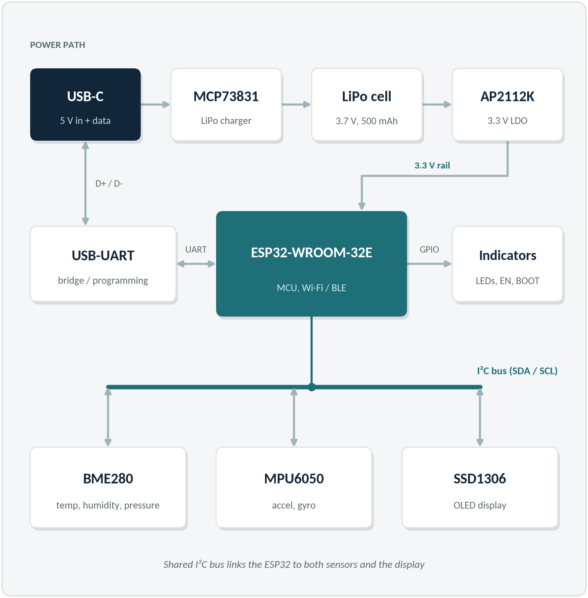

# Environmental & Motion Sensor Node

> A portable ESP32 sensor node on a custom two-layer PCB, designed in Altium Designer for the AMP Lab at Virginia Tech.

## Contact

- **Name:** Piyush Goswami
- **Virginia Tech Email:** piyushgos21@vt.edu
- **GitHub:** https://github.com/piyushgos21
- **LinkedIn:** https://www.linkedin.com/in/piyush-goswami-113b7840a/ 

## Project Overview

**Goal:** Design, assemble, and test a compact sensor-node PCB that measures environmental conditions and motion, displays readings locally, and transmits data wirelessly.

The planned board uses an ESP32-WROOM-32E module to read temperature, humidity, and pressure from a BME280 and acceleration and angular velocity from an MPU6050. An SSD1306 OLED displays live measurements, while Wi-Fi or Bluetooth LE provides wireless communication.

The board is intended to operate from USB-C or a 500 mAh LiPo battery, with onboard charging and 3.3 V regulation. The final power circuit will be checked during schematic development.

### Background

This is my first complete custom PCB project. I want to work through the full process, from selecting components and drawing a schematic to assembling a board and debugging it in the AMP Lab.

I also want to structure the sensor output so it can support a future motion-classification model, connecting this project to my interest in machine learning. Training that model is outside the current project scope. This project only focuses on the hardware and the firmware needed to test and demonstrate it.

### Design Targets

| Target | Planned Implementation |
|---|---|
| PCB | Custom two-layer board |
| Design software | Altium Designer |
| Controller | ESP32-WROOM-32E-N4 |
| Environmental sensing | BME280: temperature, humidity, and pressure |
| Motion sensing | MPU6050: acceleration and angular velocity |
| Local display | SSD1306 I²C OLED |
| Peripheral interface | One shared I²C bus |
| Wireless communication | Wi-Fi or Bluetooth LE |
| Power | USB-C and a 500 mAh single-cell LiPo battery |
| Logic supply | 3.3 V |

These are planned targets. Exact components and circuit details will be finalized during schematic review.

## What I Hope to Learn

**PCB design**
- Schematic capture, component library sourcing, and footprint verification in Altium Designer.
- Component placement, routing, electrical rule checks (ERC), and design rule checks (DRC).
- Generating manufacturing and assembly files.

**Power design**
- LiPo charging and selecting a suitable USB/battery power arrangement.
- Voltage regulation and decoupling.
- Choosing components that can handle the ESP32's current demands.

**Embedded systems**
- Connecting multiple I²C devices on one bus.
- Checking device addresses, pull-up resistors, and logic levels.
- Reading sensors, updating a display, and transmitting measurements wirelessly.
- Structuring timestamped sensor output for future analysis.

**Assembly and testing**
- Soldering and assembling a custom PCB in the AMP Lab.
- Bringing up the power supply, microcontroller, and peripherals in stages.
- Debugging hardware and documenting test results.

## Design and Implementation

**Current stage:** Schematic capture is in progress in Altium Designer. The ESP32 reset and boot controls, USB-to-UART bridge, resonator, and USB-C connector are on the schematic. The bridge reset circuit is next.

*Proposal-stage block diagram. The power path will be reviewed and updated as the schematic develops.*

The system has five main parts:

1. **Controller:** An ESP32-WROOM-32E-N4 handles sensor readings, display updates, and wireless communication.
2. **Sensors:** A BME280 module measures environmental conditions, and an MPU6050 module measures motion.
3. **Display:** An SSD1306 OLED shares the I²C bus with the sensors and displays live measurements.
4. **Programming and controls:** The USB-C connector feeds an MCP2200-I/SS USB-to-UART bridge with a 12 MHz resonator. RESET and BOOT buttons support manual programming. Indicator LEDs are planned.
5. **Power:** The proposed design includes an MCP73831 LiPo charger, a 500 mAh battery, and an AP2112K 3.3 V regulator. Supporting circuitry and the USB/battery power arrangement still need to be finalized.

### Schematic Review Priorities

Before moving to PCB layout, I plan to check:

- Component symbols and footprints against manufacturer datasheets.
- Exact sensor and display module pinouts and dimensions.
- USB/battery power selection and operation while charging.
- Battery protection requirements.
- Regulator voltage headroom, current capacity, and thermal limits.
- ESP32 programming, boot/reset circuitry, and decoupling.
- I²C addresses, pull-up resistors, and logic levels.

### Planned Testing

Testing will begin with the power rails, followed by ESP32 programming and individual sensor checks. Once each peripheral works, I will test the display and wireless communication together.

Measurements, problems, and design changes will be recorded as the project progresses.

## Bill of Materials

### Parts placed on the schematic

Quantities are per board. These selections cover the schematic through November 7, 2026.

| Reference | Function or value | Qty | Manufacturer part number | DigiKey order number |
|---|---|---:|---|---|
| U1 | ESP32 module, 4 MB, PCB antenna | 1 | ESP32-WROOM-32E-N4 | 1965-ESP32-WROOM-32E-N4CT-ND |
| U2 | USB-to-UART bridge | 1 | MCP2200-I/SS | MCP2200-I/SS-ND |
| Y1 | 12 MHz ceramic resonator | 1 | CSTNE12M0GH5L000R0 | 490-17947-1-ND |
| J1 | USB-C receptacle | 1 | 10174570-00A11LF | 609-10174570-00A11LFCT-ND |
| C1, C4 | 100 nF | 2 | CL21B104KBCNNNC | 1276-1003-1-ND |
| C2 | 10 µF, 16 V | 1 | GMC21X7R106M16NT | 4713-GMC21X7R106M16NTCT-ND |
| C3 | 1 µF | 1 | GRM21BR71C105KA01L | 490-1691-1-ND |
| C5 | 0.47 µF | 1 | GRM21BR71H474KA88L | 490-3328-1-ND |
| R1, R2 | 10 kΩ pull-ups | 2 | RC0805FR-0710KL | 311-10.0KCRCT-ND |
| R3, R4 | 5.1 kΩ USB-C CC pull-downs | 2 | RC0805FR-075K1L | 311-5.10KCRCT-ND |
| SW1, SW2 | RESET and BOOT buttons | 2 | B3U-1000P | SW1020CT-ND |

### Original proposal budget

The following estimates come from the project proposal. Component selections and prices will be updated after schematic review.

Multipacks and the PCB fabrication run include spares. This budget does not cover five fully assembled sensor nodes.

| Item | Purchase Quantity | Estimated Line Cost | Link |
|---|---|---:|---|
| ESP32-WROOM-32E-N4 | 1 | $5.00 | [DigiKey](https://www.digikey.com/en/products/detail/espressif-systems/ESP32-WROOM-32E-N4/11613125) |
| FT231XS-R USB-to-UART bridge | 1 | $1.00 | [DigiKey](https://www.digikey.com/en/products/detail/ftdi-future-technology-devices-international-ltd/FT231XS-R/3029139) |
| BME280 sensor module | 1 two-pack | $14.00 | [Proposal selection](https://www.amazon.com/dp/B0DHPCFJD6) |
| MPU6050 sensor module | 1 | $8.50 | [Proposal selection](https://www.amazon.com/dp/B0HF431N5W) |
| SSD1306 I²C OLED module | 1 three-pack | $10.00 | [Proposal selection](https://www.amazon.com/dp/B0D2RMQQHR) |
| MCP73831T-2ACI/OT LiPo charger | 1 | $1.00 | [DigiKey](https://www.digikey.com/en/products/detail/microchip-technology/MCP73831T-2ACI-OT/964301) |
| AP2112K-3.3TRG1 regulator | 1 | $1.00 | [DigiKey](https://www.digikey.com/en/products/detail/diodes-incorporated/AP2112K-3-3TRG1/4470746) |
| LJ503035 500 mAh LiPo battery | 1 | $12.00 | [DigiKey](https://www.digikey.com/en/products/detail/jameco-electronics/LJ503035/25966108) |
| 10174570-00A11LF USB-C connector | 1 | $1.00 | [DigiKey](https://www.digikey.com/en/products/detail/amphenol-cs-fci/10174570-00A11LF/24366703) |
| Passives, headers, buttons, LEDs, and battery connector | 1 set | ~$7.00 | [Detailed breakdown below](#supporting-components) |
| Two-layer PCB fabrication | 5 bare boards | ~$25.00 | Proposal estimate |

### Supporting Components
Detailed preliminary selections from the project proposal. Quantities and component choices will be checked during schematic development. Prices are proposal estimates, not current supplier quotes.

| Part | Manufacturer Part Number | Quantity | Estimated Unit Cost | Estimated Line Cost |
|---|---|---:|---:|---:|
| 10 kΩ resistor | [RC0805FR-0710KL](https://www.digikey.com/en/products/detail/yageo/RC0805FR-0710KL/727535) | 2 | $0.10 | $0.20 |
| 5.1 kΩ resistor — USB-C CC pins | [RC0805FR-075K1L](https://www.digikey.com/en/products/detail/yageo/RC0805FR-075K1L/727988) | 2 | $0.10 | $0.20 |
| 4.99 kΩ resistor — charger programming | [RC0805FR-074K99L](https://www.digikey.com/en/products/detail/yageo/RC0805FR-074K99L/727938) | 1 | $0.10 | $0.10 |
| 4.7 kΩ resistor — I²C pull-ups | [RC0805FR-074K7L](https://www.digikey.com/en/products/detail/yageo/RC0805FR-074K7L/727929) | 2 | $0.10 | $0.20 |
| 1 kΩ resistor — LEDs | [RC0805FR-071KL](https://www.digikey.com/en/products/detail/yageo/RC0805FR-071KL/727444) | 3 | $0.10 | $0.30 |
| 0.1 µF capacitor, 50 V | [CL21B104KBCNNNC](https://www.digikey.com/en/products/detail/samsung-electro-mechanics/CL21B104KBCNNNC/3886661) | 6 | $0.10 | $0.60 |
| 10 µF capacitor, 25 V | [CL21A106KAYNNNE](https://www.digikey.com/en/products/detail/samsung-electro-mechanics/CL21A106KAYNNNE/3888549) | 4 | $0.30 | $1.20 |
| Red LED | [150080RS75000](https://www.digikey.com/en/products/detail/w%C3%BCrth-elektronik/150080RS75000/4489918) | 2 | $0.25 | $0.50 |
| Green LED | [150080GS75000](https://www.digikey.com/en/products/detail/w%C3%BCrth-elektronik/150080GS75000/4489915) | 1 | $0.25 | $0.25 |
| Tactile button — EN and BOOT | [B3U-1000P](https://www.digikey.com/en/products/detail/aratas-formerly-omron-components/B3U-1000P/1534338) | 2 | $0.50 | $1.00 |
| Female header, 1×4 | [PPPC041LFBN-RC](https://www.digikey.com/en/products/detail/sullins-connector-solutions/PPPC041LFBN-RC/810176) | 2 | $0.50 | $1.00 |
| Female header, 1×8 | [PPPC081LFBN-RC](https://www.digikey.com/en/products/detail/sullins-connector-solutions/PPPC081LFBN-RC/810180) | 1 | $0.80 | $0.80 |
| JST-PH battery connector | [S2B-PH-SM4-GW-TB](https://www.digikey.com/en/products/detail/jst-sales-america-inc/s2b-ph-sm4-gw-tb/27506773) | 1 | $0.50 | $0.50 |
| **Total** | | | | **$6.85** |

The main BOM rounds this subtotal to **$7.00**. This breakdown is already included in the overall project budget and should not be added a second time.

**Design changes since the proposal:** U2 changed from FT231XS-R to MCP2200-I/SS, and C2 changed from CL21A106KAYNNNE to GMC21X7R106M16NT. The current schematic selections are listed above. The replacement C2 land pattern still needs dimensional verification.

**Original proposal estimate: $85.50**
This is the preliminary proposal estimate. Final costs will be updated after component selection and confirmation of shipping, taxes, and fabrication costs.

## Timeline and Milestones

| Milestone | Target Date | Status |
|---|---|---|
| Project proposal presented to the AMP Lab and approved | Oct 30, 2026 | Complete |
| Repository created and initial README written | Nov 1, 2026 | Complete |
| Project planning and preliminary component review | Nov 8, 2026 | In progress |
| Initial design and schematic complete | Dec 15, 2026 | In progress |
| PCB layout complete and boards ordered | Jan 15, 2027 | Not started |
| Prototype assembled | Feb 15, 2027 | Not started |
| Testing and bring-up | Mar 1, 2027 | Not started |
| Project completion | Mar 15, 2027 | Not started |

Target dates will be updated as design, fabrication, and testing progress.

## Progress Log

### 2026-10-30

Presented my Environmental & Motion Sensor Node project proposal to the AMP Lab and received approval. The proposal covered the system concept, learning goals, preliminary components and budget, and the plan for designing and building a custom PCB.

### 2026-11-01

Created this repository and wrote the initial README to document the project overview, learning goals, and planned milestones.

### 2026-11-06

Updated the README and began the Altium schematic. I wired the ESP32 supply, decoupling capacitors, and manual RESET/BOOT controls. I replaced the unavailable 10 µF capacitor and linked its local schematic symbol to a PCB footprint. During validation I found and removed a wire that bypassed the GPIO0 pull-up resistor.

### 2026-11-07

I changed the USB-to-UART bridge to the MCP2200-I/SS and connected its TX and RX pins to the ESP32. I added the 12 MHz resonator and corrected its symbol pin types after Altium reported conflicting outputs. I wired the USB-C data contacts for both plug orientations, added separate CC pull-downs, and grounded the connector shell. The bridge supply and bypass capacitors are connected to the 3.3 V rail. USB communication has not yet been tested.

## What's Next

- Add the proposed USB-presence reset circuit for U2: U3 (SN74LVC1G17DBVRG4), R5 (10 kΩ), and C6 (100 nF). U2 pin 4 is open at this stage. Validate the schematic again after wiring it.
- Verify C2's land pattern, J1's ground-pad mapping, and the USB-C connector fit for the chosen PCB thickness.
- Confirm the module pinouts, I²C addresses, and pull-ups before wiring the sensors and OLED.
- Finalize USB/battery power selection, charging, protection, and 3.3 V regulation before layout.

## Project Files

Currently included:

- [README.md](./README.md): Project overview, component plan, timeline, and progress log.
- [hero.png](./hero.png): Proposal-stage system block diagram.

Files to be added as the project develops:

- Altium project and schematic files.
- PCB layout files.
- Verified component libraries.
- Detailed bill of materials.
- Firmware for testing and demonstrations.
- Manufacturing files.
- Assembly photos and test results.

## Useful Links

- [Altium Designer Documentation](https://www.altium.com/documentation/altium-designer)
- [Creating an Altium Project and Schematic](https://www.altium.com/documentation/altium-designer/tutorial/creating-project-schematic-document)
- [Microchip MCP73831 Product Information](https://www.microchip.com/en-us/product/MCP73831)
- [Microchip System Power-Path Reference Design](https://www.microchip.com/en-us/development-tool/MCP7383XRD-PPM)
